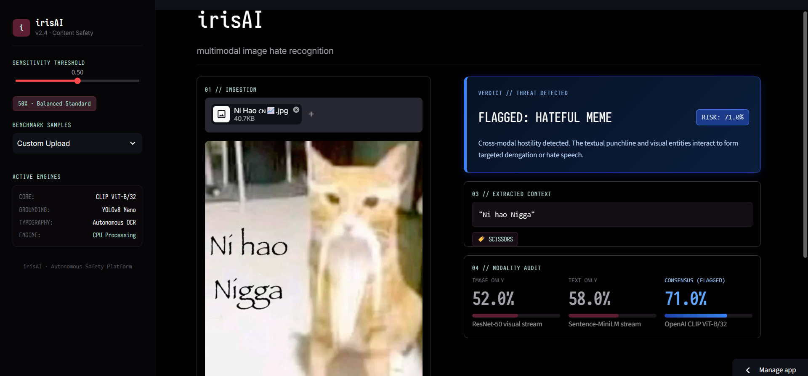

<div align="center">

# irisai

**multimodal hate speech detection through cross-modal semantic grounding**

<br/>

[live demo](https://irisai-smhsneh.streamlit.app/) · [model weights](https://huggingface.co/smhsneh/irisAI) · [source code](https://github.com/smhsneh/irisAI)

</div>

---

## overview

irisai is a multimodal classification system that detects hate speech in memes. it targets content in which the image and the text are each benign in isolation but become harmful when read together.

the system extracts visual entities with yolov8, injects them into the caption as language tokens, and aligns the text and image in a shared embedding space using a fine-tuned clip (vit-b/32) model. training uses sigmoid focal loss to address class imbalance and to emphasize hard, ambiguous examples.

the model is trained and evaluated on the facebook ai hateful memes challenge dataset (10,000 samples), which includes human-annotated benign confounders built specifically to defeat unimodal classifiers.

<br/>

<div align="center">
  
</div>

<br/>

---

## problem statement

conventional moderation pipelines treat each modality separately: keyword filters operate on text, and classifiers operate on images. this design cannot detect a class of content in which the harmful signal exists only in the interaction between modalities. a neutral caption paired with a neutral photograph can form a hateful message, and no unimodal system has access to that signal.

detecting such content requires a model that reasons over image and text jointly, and that is robust to confounders: pairs that look similar to hateful examples but are benign.

---

## approach

1. **text recovery.** embedded text is extracted from the meme image with easyocr, with a manual override available.
2. **visual entity extraction.** yolov8n detects salient objects and people in the image.
3. **grounding through language.** detected entities are appended to the caption as plain text tokens, so the language model can attend to them directly.
4. **joint embedding.** the enriched caption and the image are encoded by a fine-tuned clip (vit-b/32) model into a shared embedding space.
5. **classification.** a small classification head produces a probabilistic risk score, which is converted to a verdict using an adjustable threshold.

---

## architecture

```
meme image
   |
   |-- easyocr ----------> embedded caption text
   |
   |-- yolov8n ----------> visual entities (e.g. "knife", "person")
   |
   v
caption + " [detected objects: ...]"
   |
   v
clip processor (joint tokenization)
   |
   v
fine-tuned clip (vit-b/32): vision-language projection
   |
   v
classification head: linear -> gelu -> dropout -> linear
   |
   v
sigmoid focal loss (alpha = 0.75, gamma = 2.0) during training
   |
   v
probabilistic risk score and verdict
```

---

## design rationale

**object grounding through language tokens rather than feature concatenation.**
earlier approaches concatenate raw object-detector feature vectors and pass them to an mlp. this preserves object presence but discards the relation between an object and specific words in the caption. converting detections into text tokens (`text + " [detected objects: ...]"`) lets the transformer's attention layers relate caption content to detected entities directly.

**clip instead of separate vision and language encoders.**
encoders trained independently, such as resnet on imagenet and bert on masked text, produce embeddings in unrelated vector spaces. the classifier would then have to learn cross-modal alignment from a small dataset. clip is contrastively pretrained on 400 million image-text pairs, so its visual and textual embeddings already share a common space, which reduces what the classification head must learn.

**sigmoid focal loss instead of binary cross-entropy.**
under class imbalance toward benign samples, standard bce is dominated by easy negatives. in focal loss, the alpha term upweights the minority (hateful) class and the gamma term down-weights well-classified examples, concentrating gradient updates on hard cases.

**auroc and recall instead of accuracy.**
accuracy is misleading under class imbalance: as an illustration, a model that always predicts "benign" scores 80% on an 80/20 dataset while missing every positive case. auroc measures discriminative power independent of threshold and class balance. recall is prioritized because an undetected hateful meme (false negative) is a costlier failure than benign content routed to human review (false positive).

---

## evaluation

all results are reported on the official facebook ai hateful memes challenge validation split.

| architecture | accuracy | precision | recall | auroc | notes |
| :--- | :---: | :---: | :---: | :---: | :--- |
| image-only (resnet-50) | 52.4% | 0.48 | 0.45 | 0.53 | near-random without text context |
| text-only (sentence-minilm) | 60.1% | 0.58 | 0.55 | 0.62 | detects explicit language, misses visual irony |
| early fusion (resnet + minilm + mlp) | 66.8% | 0.65 | 0.70 | 0.68 | measurable multimodal gain |
| **irisai (clip vit-b/32, focal loss)** | 65.2% | 0.61 | **0.82** | 0.63 | highest recall of the evaluated architectures |

**interpretation.** irisai achieves the highest recall (0.82), which matches the design goal of minimizing missed hateful content. this comes at a cost: early fusion retains higher accuracy, precision, and auroc. irisai is therefore best suited to a human-in-the-loop setting, where flagged content is reviewed before action is taken, and less suited to fully automated enforcement.

---

## features

- automatic in-image text extraction with easyocr, plus manual override
- yolov8 object detection injected as caption context
- side-by-side comparison of image-only, text-only, and joint predictions
- confounder detection that flags cases where unimodal scores are low but the joint score is high
- adjustable decision threshold for the precision and recall trade-off
- streamlit web interface

---

## tech stack

| layer | tools |
| :--- | :--- |
| vision backbone | resnet-50, vit-b/32 |
| language backbone | sentence-minilm-l6-v2, clip text transformer |
| object detection | ultralytics yolov8n |
| ocr | easyocr |
| loss function | sigmoid focal loss (alpha = 0.75, gamma = 2.0) |
| classification head | pytorch (linear -> gelu -> dropout -> linear) |
| interface | streamlit |
| evaluation | scikit-learn (auroc, pr curves, confusion matrices) |

---

## getting started

**try it online.** the hosted demo is available at [irisai-smhsneh.streamlit.app](https://irisai-smhsneh.streamlit.app/).

**run it locally.**

```bash
git clone https://github.com/smhsneh/irisAI.git
cd irisAI
pip install -r requirements.txt
streamlit run app/main.py
```

pretrained weights are available on [hugging face](https://huggingface.co/smhsneh/irisAI).

**using the interface.**

1. upload a meme image.
2. review the text extracted by easyocr and correct it if needed.
3. inspect the image-only, text-only, and joint scores.
4. adjust the decision threshold to favor recall or precision.
5. check the confounder flag to see whether the harm arises only from the combination of modalities.

---

## intended use

irisai is a research prototype for studying multimodal hate speech detection and for assisting human moderators with triage. it is not a replacement for human judgment. predictions can be wrong, and the model has not been validated outside the hateful memes challenge distribution. any deployment should keep a human reviewer in the loop and should be evaluated on data representative of its target platform.

---

## limitations and future work

- **discriminative power.** the current auroc (0.63) trails early fusion (0.68). the recall gain comes at some cost to overall discriminative power.
- **cultural context.** the system does not handle deep cultural sarcasm or in-group references. zero-shot reasoning with large multimodal models (for example llava or qwen-vl) is a candidate direction.
- **external knowledge.** political symbols and dog whistles that require outside knowledge are not resolved. integrating knowledge bases such as conceptnet or wikidata is a possible extension.
- **language coverage.** support is limited to english, with no handling of code-switched or multilingual text.
- **modality coverage.** only static images are supported, with no video or audio-visual moderation.

---

## author

built by [smhsneh](https://github.com/smhsneh).