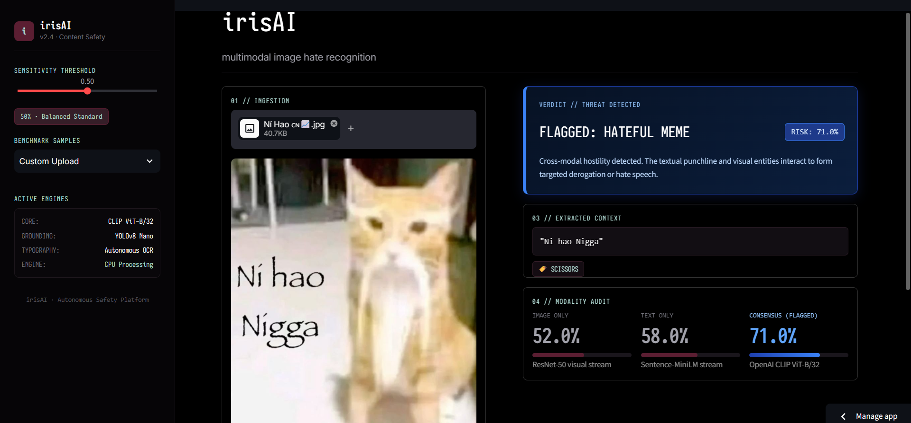

<div align="center">

# irisai

**multimodal hate speech detection through cross-modal semantic grounding**

<br/>

[live demo](https://huggingface.co/spaces/smhsneh/irisAI) · [model weights](https://huggingface.co/smhsneh/irisAI) · [source code](https://github.com/smhsneh/irisAI)

</div>

---

## overview

irisai is a multimodal classification system that detects hate speech in memes. it targets content in which the image and the text are each benign in isolation but become harmful when read together.

the system extracts visual entities with yolov8, injects them into the caption as language tokens, and aligns visual and textual modalities using a frozen clip-large (vit-l/14) backbone combined with a low-rank bilinear fusion head ensemble. training uses sigmoid focal loss to address class imbalance and emphasize hard, ambiguous examples.

the model is evaluated on the facebook ai hateful memes challenge dataset (10,000 samples), which includes human-annotated benign confounders built specifically to defeat unimodal classifiers.

<br/>

<div align="center">
  
</div>

<br/>

---

## problem statement

conventional moderation pipelines treat each modality separately: keyword filters operate on text, and classifiers operate on images. this design cannot detect a class of content in which the harmful signal exists only in the interaction between modalities. a neutral caption paired with a neutral photograph can form a hateful message, and no unimodal system has access to that signal.

detecting such content requires a model that reasons over image and text jointly, and that is robust to confounders: pairs that look similar to hateful examples but are benign.

---

## approach

1. **text recovery.** embedded text is extracted from the meme image with easyocr, with a manual override available.
2. **visual entity extraction.** yolov8n detects salient objects and people in the image.
3. **grounding through language.** detected entities are appended to the caption as plain text tokens (`caption + " [detected objects: ...]"`), so the language model can attend to them directly.
4. **joint embedding.** the enriched caption and the image are encoded by a frozen clip-large (vit-l/14) model into l2-normalized 768-dimensional vector representations.
5. **bilinear cross-modal interaction.** a low-rank bilinear fusion head computes element-wise hadamard interactions between projected image and text features, concatenated with the original embeddings.
6. **three-seed ensembling & calibration.** predictions from three seeds (42, 7, 123) are averaged and calibrated via temperature scaling ($t = 0.8908$).
7. **3-tier triage decision.** memes are classified into cleared (< 0.40), review (0.40–0.60), and flagged ($\ge 0.60$), with a separate lexical text screener acting as an escalation safeguard.

---

## architecture

```
meme image
   |
   |-- easyocr ----------> embedded caption text
   |
   |-- yolov8n ----------> visual entities (e.g. "knife", "person")
   |
   v
caption + " [detected objects: ...]"
   |
   v
openai/clip-vit-large-patch14 (frozen, 768-d pooled embeddings)
   |
   +--> image_embeds (768-d, l2-normalized)
   +--> text_embeds  (768-d, l2-normalized)
   |
   v
bilinear fusion head (low-rank hadamard interaction: w_v(e_img) * w_t(e_txt))
   |
   v
3-seed probability ensemble (seeds 42, 7, 123)
   |
   v
temperature scaling calibration (t = 0.8908)
   |
   v
calibrated risk score & 3-tier triage verdict (cleared / review / flagged)
```

---

## design rationale

**object grounding through language tokens rather than feature concatenation.**
earlier approaches concatenate raw object-detector feature vectors and pass them to an mlp. this preserves object presence but discards the relation between an object and specific words in the caption. converting detections into text tokens (`text + " [detected objects: ...]"`) lets the transformer's attention layers relate caption content to detected entities directly.

**clip-large backbone over separate unimodal encoders.**
encoders trained independently produce embeddings in unrelated vector spaces. clip is contrastively pretrained on 400 million image-text pairs, so visual and textual embeddings already share an aligned semantic space. upgrading from vit-b/32 to vit-l/14 (14x14 patches, 768-d) captures finer visual detail for small text overlays and facial expressions.

**bilinear hadamard pooling over simple concatenation.**
concatenation forces a subsequent linear layer to model multimodal cross-terms implicitly. the bilinear head explicitly computes $h = (w_v e_{img}) \odot (w_t e_{txt})$, directly isolating cross-modal mismatches and subtle bimodal irony.

**sigmoid focal loss instead of binary cross-entropy.**
under class imbalance toward benign samples, standard bce is dominated by easy negatives. in focal loss, the alpha term ($\alpha = 0.75$) upweights the minority hateful class and the gamma term ($\gamma = 2.0$) down-weights well-classified examples, concentrating gradient updates on hard cases.

**auroc as primary benchmark metric.**
accuracy can be inflated under class imbalance by predicting benign. auroc measures ranking capability across all thresholds independent of decision boundary. all model comparisons are evaluated strictly by auroc.

---

## evaluation

all reported results are evaluated on the official 500-sample facebook ai hateful memes challenge development split (`dev_yolo.jsonl`). no labelled test results are claimed.

| architecture | dev auroc | dev accuracy | dev precision | dev recall | notes |
| :--- | :---: | :---: | :---: | :---: | :--- |
| image-only (resnet-50) | 0.53 | 52.4% | 0.48 | 0.45 | near-random without caption context |
| text-only (sentence-minilm) | 0.62 | 60.1% | 0.58 | 0.55 | detects explicit slurs, misses visual irony |
| clip-base (vit-b/32 linear head) | 0.63 | 65.2% | 0.61 | **0.82** | high recall baseline, moderate discrimination |
| early fusion (resnet + minilm + mlp) | 0.68 | 66.8% | 0.65 | 0.70 | classical unimodal concatenation |
| cross-attention (clip-large) | 0.616 | - | - | - | unstable under shared configuration (lr 1e-3, no warmup) |
| transformer fusion (clip-large) | 0.593 | - | - | - | seeds 7 and 123 collapsed to near-constant output |
| bilinear head (seed 42) | 0.774 | - | - | - | epoch 3 checkpoint (val macro-f1: 0.7168) |
| bilinear head (seed 7) | 0.773 | - | - | - | epoch 4 checkpoint (val macro-f1: 0.7072) |
| bilinear head (seed 123) | 0.765 | - | - | - | epoch 5 checkpoint (val macro-f1: 0.7114) |
| **irisai (clip-large + bilinear ensemble)** | **0.784** | - | - | - | **headline deployed model (calibrated 3-seed ensemble)** |

**interpretation.** bilinear fusion on clip-large achieves **0.784 dev auroc**, significantly exceeding early fusion (0.68) and clip-base (0.63). cross-attention and transformer fusion were unstable under the shared optimization hyperparameters without learning-rate warmup.

---

## 3-tier triage protocol

to convert calibrated probabilities into actionable moderation decisions, the system replaces single-threshold cut-offs with a 3-tier triage queue derived on the dev set:

| tier | calibrated risk | dev samples | dev share | fraction hateful | share of all hateful |
| :--- | :---: | :---: | :---: | :---: | :---: |
| **cleared** | $< 0.40$ | 221 | 44.2% | 25.3% | 22.4% |
| **review** | $0.40 - 0.60$ | 124 | 24.8% | 58.9% | 29.2% |
| **flagged** | $\ge 0.60$ | 155 | 31.0% | 78.1% | 48.4% |

*note*: an independent rule-based lexical screener scans for high-severity slurs and cyberbullying terms. it can escalate a sample from cleared to review, but operates strictly as a safety layer and is not part of the model's reported metrics.

---

## tech stack

| layer | tools |
| :--- | :--- |
| vision backbone | openai/clip-vit-large-patch14 (frozen, 768-d) |
| language backbone | openai/clip-vit-large-patch14 text transformer (frozen, 768-d) |
| object detection | ultralytics yolov8n |
| text recovery | easyocr |
| fusion mechanism | low-rank hadamard bilinear pooling (`bilinearfusionhead`) |
| calibration | temperature scaling ($t = 0.8908$) |
| deployment | streamlit on hugging face spaces (`deploy/hf_space/`) |
| evaluation | scikit-learn (auroc, reliability diagrams, tier sweeps) |

---

## getting started

**try it online.** the live interactive application is hosted on hugging face spaces at [huggingface.co/spaces/smhsneh/irisAI](https://huggingface.co/spaces/smhsneh/irisAI).

**run the deployment app locally.**

```bash
cd deploy/hf_space
pip install -r requirements.txt
streamlit run app/main.py
```

**verify dev parity.**

```bash
python deploy/hf_space/check_dev_auroc.py --features research/dev_clip_features.pt
```

---

## repository layout

```
irisai/
├── deploy/
│   └── hf_space/           # standalone hugging face space deployment files
│       ├── app/main.py     # streamlit live moderation interface
│       ├── src/            # inference engine and bilinear head definitions
│       ├── weights/        # bilinear checkpoints (seeds 42, 7, 123)
│       └── requirements.txt
├── research/               # research handoff artifacts & analysis
│   ├── figures/            # publication-ready evaluation charts (fig01–fig09)
│   ├── dev_clip_features.pt# cached clip-large validation vectors
│   ├── irisai-friend.ipynb # extraction & validation notebook
│   └── tier_summary_dev.csv# dev tier distribution summary
├── figures/                # report and paper figures
└── data/                   # annotations (images excluded per dataset license)
```

---

## intended use

irisai is a research prototype for studying multimodal hate speech detection and assisting human moderators with triage queues. it is not a replacement for human judgment. predictions have not been validated outside the hateful memes challenge distribution.

---

## limitations and future work

- **inference latency.** on free cpu containers, feature extraction and visual grounding take ~3.3 seconds per meme. gpu acceleration is recommended for real-time throughput.
- **cultural context & code-switching.** the model is trained on english multimodal pairs and does not resolve regional idioms or transliterated vernacular.
- **adversarial confounders.** memes relying exclusively on external world knowledge or covert dog whistles require external knowledge-graph grounding.

---

## author

built by [smhsneh](https://github.com/smhsneh).
